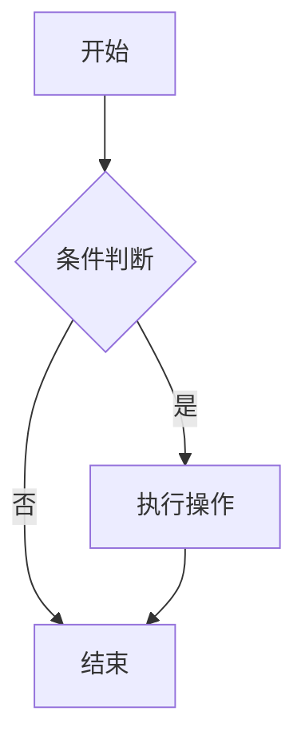
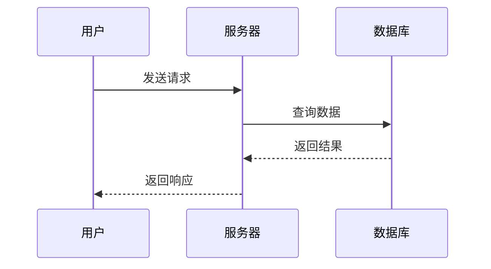
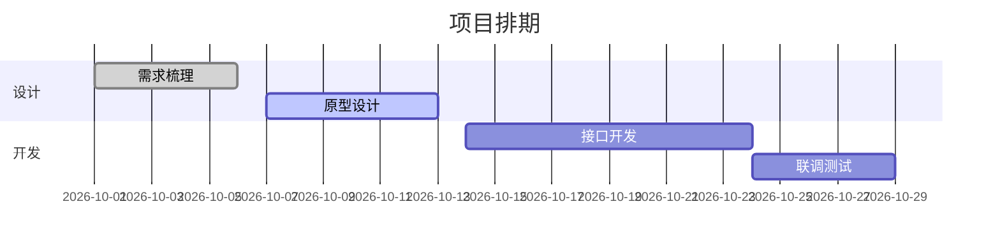
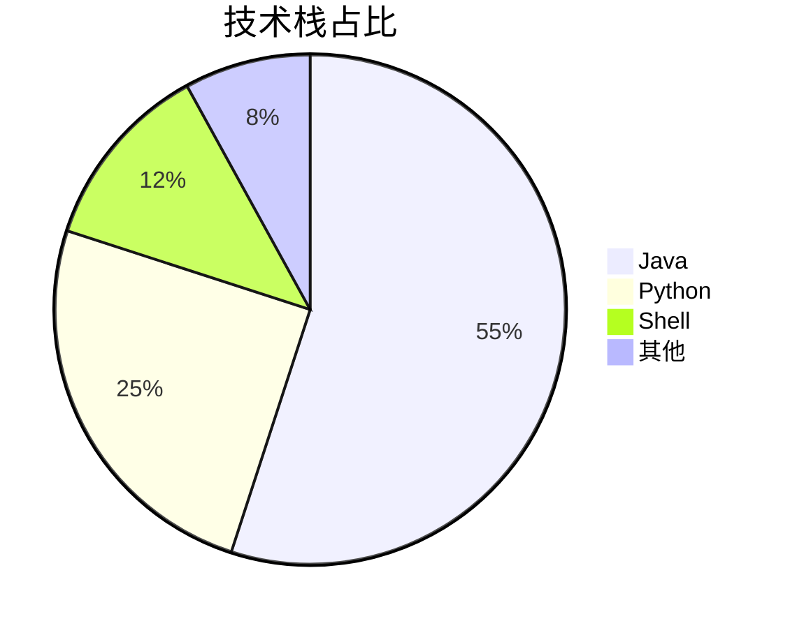

# Markdown 预览测试文件

> 本文件用于测试 Markdown 预览软件对各种语法的渲染效果。
> 涵盖标题、文本样式、列表、表格、代码、引用、链接、图片、任务列表、数学公式、图表、原生 HTML 等常见元素。
>
> 测试建议：逐节对照左侧源码与右侧预览，关注字体、间距、配色、代码高亮、表格对齐与滚动行为。

---

## 目录

1. [标题层级](#1-标题层级headings)
2. [文本样式](#2-文本样式text-styles)
3. [段落与换行](#3-段落与换行)
4. [列表](#4-列表lists)
5. [引用](#5-引用blockquote)
6. [代码块](#6-代码块code-blocks)
7. [表格](#7-表格tables)
8. [链接与图片](#8-链接与图片links--images)
9. [分隔线](#9-分隔线horizontal-rules)
10. [脚注](#10-脚注footnotes)
11. [数学公式](#11-数学公式mathlatex)
12. [Mermaid 图表](#12-mermaid-图表)
13. [原生 HTML](#13-原生-htmlraw-html)
14. [转义与特殊字符](#14-特殊字符与转义)
15. [Emoji 与图标](#15-emoji-与图标)
16. [复杂嵌套组合](#16-复杂嵌套组合)
17. [长文本与换行](#17-长文本与换行)
18. [渲染能力自查表](#18-渲染能力自查表)

---

## 1. 标题层级（Headings）

# 一级标题 H1
## 二级标题 H2
### 三级标题 H3
#### 四级标题 H4
##### 五级标题 H5
###### 六级标题 H6

带 `#` 的文本（行首转义）：\# 这不是标题

标题中的行内样式：**加粗标题** 与 `代码标题`（视渲染器支持情况）

---

## 2. 文本样式（Text Styles）

- **加粗文本**（`**加粗**` 或 `__加粗__`）
- *斜体文本*（`*斜体*` 或 `_斜体_`）
- ***加粗斜体***（`***加粗斜体***`）
- ~~删除线~~（`~~删除线~~`）
- `行内代码`（反引号包裹）
- ==高亮文本==（部分渲染器支持，扩展语法）
- 上标：H<sub>2</sub>O、X<sup>2</sup>（HTML 标签方式）
- 下标：CO<sub>2</sub>
- 键盘按键：<kbd>Ctrl</kbd> + <kbd>Shift</kbd> + <kbd>P</kbd>
- 标记文本：<mark>被标记的内容</mark>
- 小字号：<small>小号说明文字</small>
- 下划线：<u>带下划线的文本</u>

组合示例：**粗体 + *斜体嵌套* + `代码` + ~~删除~~** 混排效果。

连续标点与中英混排：中文，English, 数字 12345，符号 @#$%^&*()_+ —— 测试字距与断行。

---

## 3. 段落与换行

这是第一个段落，用于展示普通正文样式。Markdown 中两个空格加换行会强制换行。

这是第二个段落，紧跟其后展示段落间距的渲染情况。

强制换行示例（行尾两个空格）：  
第一行结尾有两个空格，  
所以这里应当另起一行，而不是新段落。

---

## 4. 列表（Lists）

### 4.1 无序列表

- 水果
  - 苹果
  - 香蕉
    - 进口香蕉
    - 本地香蕉
- 蔬菜
- 肉类

### 4.2 有序列表

1. 第一步：准备材料
2. 第二步：混合搅拌
3. 第三步：烘焙出炉
   1. 预热烤箱
   2. 设定温度
4. 第四步：冷却装盘

### 4.3 有序列表起始序号

3. 从第三项开始
4. 第四项
5. 第五项

### 4.4 任务列表（Task List）

- [x] 已完成任务
- [ ] 未完成任务
- [ ] 计划中任务
  - [x] 子任务 A
  - [ ] 子任务 B

### 4.5 列表中的多段落与代码

- 列表项第一段
- 列表项第二段，包含 `行内代码`

  ```text
  列表内缩进的代码块
  ```

- 列表项第三段，包含引用：
  > 列表内的引用块

### 4.6 定义列表（扩展语法，部分渲染器支持）

术语 A
: 术语 A 的解释说明。

术语 B
: 术语 B 的解释说明，可以写多行。

---

## 5. 引用（Blockquote）

> 这是一级引用。
>
> > 这是嵌套引用，用于测试多级引用渲染。
> >
> > > 这是三级嵌套引用。
>
> 引用中也可以包含 **加粗**、*斜体* 与 `代码`。

> **提示**
>
> 引用块内可以有列表：
>
> 1. 第一点
> 2. 第二点
>
> 以及代码：
>
> ```js
> console.log("quote code");
> ```

---

## 6. 代码块（Code Blocks）

### 6.1 行内代码

使用 `System.out.println("Hello, Markdown!")` 可以输出文本。

行内代码中含反引号：`` `code with ` backtick ``

### 6.2 Java

```java
public class HelloWorld {
    public static void main(String[] args) {
        System.out.println("Hello, Markdown!");
    }
}
```

### 6.3 Python

```python
def fibonacci(n: int) -> int:
    a, b = 0, 1
    for _ in range(n):
        a, b = b, a + b
    return a


if __name__ == "__main__":
    print(fibonacci(10))
```

### 6.4 SQL

```sql
SELECT u.id,
       u.user_name,
       COUNT(o.id) AS order_count
FROM sys_user u
LEFT JOIN biz_order o ON o.user_id = u.id
WHERE u.status = 1
GROUP BY u.id, u.user_name
HAVING COUNT(o.id) > 0
ORDER BY order_count DESC
LIMIT 20;
```

### 6.5 JSON

```json
{
  "name": "markdown-test",
  "version": "1.0.0",
  "features": ["table", "code", "math"],
  "enabled": true,
  "extra": null
}
```

### 6.6 Bash 与 diff

```bash
# 安装依赖并运行
npm install
npm run dev -- --port 3000
```

```diff
- const oldValue = 1;
+ const newValue = 2;
  unchanged line
```

### 6.7 无语言标识的代码块与长行滚动

```text
这是一段没有语言标识的纯文本代码块，用于测试高亮器回退为无色显示时的样式表现。
------------------------------------------------------------------
这是一行很长很长很长的内容，用于测试代码块是否会出现横向滚动条而不是自动折行：ABCDEFGHIJKLMNOPQRSTUVWXYZ0123456789abcdefghijklmnopqrstuvwxyz
```

---

## 7. 表格（Tables）

### 7.1 基础对齐

| 姓名 | 年龄 | 城市 | 是否活跃 |
| :--- | :--: | ---: | --- |
| 张三 | 28 | 北京 | 是 |
| 李四 | 32 | 上海 | 否 |
| 王五 | 45 | 广州 | 是 |

> 上表演示了左对齐（`:---`）、居中（`:--:`）与右对齐（`---:`）。

### 7.2 单元格内行内样式与长内容

| 场景 | 说明 | 状态 |
| --- | --- | :--: |
| 行内代码 | 使用 `mvn clean package` 打包 | ✅ |
| 加粗与斜体 | **必须**先 *备份* 再操作 | ⚠️ |
| 长文本 | 这是一段较长的单元格内容，用来观察表格列宽自适应、换行与最小宽度策略是否合理，是否会出现内容被截断的情况。 | ❌ |

### 7.3 宽表格（横向滚动测试）

| 序号 | 用户名 | 手机号 | 邮箱 | 部门 | 岗位 | 状态 | 创建时间 | 最后登录 | 备注 |
| ---: | --- | --- | --- | --- | --- | :--: | --- | --- | --- |
| 1 | zhangsan | 13800000001 | zhangsan@example.com | 研发中心 | 后端工程师 | 启用 | 2024-01-01 09:00:00 | 2026-10-31 22:30:00 | 无 |
| 2 | lisi | 13800000002 | lisi@example.com | 产品部 | 产品经理 | 停用 | 2023-06-15 10:20:00 | 2026-09-01 08:00:00 | 试用期 |

---

## 8. 链接与图片（Links & Images）

### 8.1 链接

- 自动链接：<https://www.example.com>
- 外部链接：[示例站点](https://www.example.com)
- 带标题的链接：[示例站点（带 title）](https://www.example.com "鼠标悬停可见")
- 引用式链接：[GitHub][gh]
- 相对链接：[回到目录](#目录)
- 纯文本网址（部分渲染器自动识别）：https://www.example.com

[gh]: https://github.com "GitHub 代码托管"

### 8.2 图片


[](https://www.example.com)

---

## 9. 分隔线（Horizontal Rules）

下面使用三种写法展示分隔线（渲染器通常统一渲染为一条线）：

---

********

___

---

## 10. 脚注（Footnotes）

这里有一个脚注引用[^1]，还有一个[^note]。

[^1]: 这是第一个脚注的内容，用于说明正文细节。
[^note]: 这是第二个脚注，演示多脚注自动编号与文末汇总。

---

## 11. 数学公式（Math，LaTeX）

行内公式：$E = mc^2$，质能方程；$a^2 + b^2 = c^2$，勾股定理。

块级公式：

$$
\int_{a}^{b} f(x)\,dx = F(b) - F(a)
$$

$$
\frac{\partial^2 u}{\partial t^2} = c^2 \nabla^2 u
$$

矩阵形式：

$$
\begin{pmatrix}
a & b \\
c & d
\end{pmatrix}
\begin{pmatrix}
x \\
y
\end{pmatrix}
=
\begin{pmatrix}
ax + by \\
cx + dy
\end{pmatrix}
$$

---

## 12. Mermaid 图表

### 12.1 流程图



### 12.2 时序图



### 12.3 甘特图



### 12.4 饼图



---

## 13. 原生 HTML（Raw HTML）

<div style="border:1px solid #888; padding:12px; border-radius:6px;">
  这是一个 <strong>HTML 容器</strong>，用于测试渲染器对原生 HTML 的支持程度。
</div>

<br>

<details>
<summary>点击展开 / 收起（details + summary）</summary>

隐藏内容：这里可以放任意 Markdown 或 HTML。

- 列表项 1
- 列表项 2

</details>

<table>
  <thead>
    <tr><th>HTML 表格</th><th>说明</th></tr>
  </thead>
  <tbody>
    <tr><td>rowspan / colspan</td><td>原生 HTML 表格可合并单元格</td></tr>
  </tbody>
</table>

---

## 14. 特殊字符与转义

需要显示字面量符号时，使用反斜杠转义：\* 不是斜体、\_ 不是强调、\# 不是标题、\` 不是代码。

常见 HTML 实体：&copy; &reg; &trade; &lt; &gt; &amp; &quot; &nbsp;|&nbsp;分隔

特殊符号：→ ← ↑ ↓ ★ ☆ ✓ ✗ ± × ÷ ≈ ≠ ≤ ≥ ∞ § ¶ † ‡ • …

---

## 15. Emoji 与图标

短代码形式：:smile: :rocket: :warning: :white_check_mark: :x:

直接字符形式：😀 🚀 ⚠️ ✅ ❌ 🔥 💡 📌

---

## 16. 复杂嵌套组合

> **架构说明**
>
> 1. 接入层
>    - Nginx 反向代理
>    - 限流与鉴权
> 2. 应用层
>    - Spring Boot 服务
>      ```java
>      @RestController
>      public class DemoController { }
>      ```
> 3. 数据层
>    - MySQL 主从
>    - Redis 缓存
>
> | 层级 | 组件 | 备注 |
> | --- | --- | --- |
> | 接入层 | Nginx | 静态资源 + 转发 |
> | 应用层 | Spring Boot | 无状态 |
> | 数据层 | MySQL / Redis | 主从 + 缓存 |

---

## 17. 长文本与换行

超长连续英文单词（测试是否溢出容器）：PneumonoultramicroscopicsilicovolcanoconiosisSupercalifragilisticexpialidociousAntidisestablishmentarianism

超长 URL：https://www.example.com/very/long/path/segment/one/two/three/four/five/six/seven/eight/nine/ten?query=abcdefghijklmnopqrstuvwxyz&another=0123456789

中英混排长段落：在高分辨率屏幕下，Markdown 预览器通常需要处理中英文混排的字距、行高与断行规则。This sentence mixes Chinese and English to check line-height consistency. 数字 2026-10-31 23:00:48 与单位 100 MB/s 也应保持正常间距。

---

## 18. 渲染能力自查表

| 语法类型 | 是否常用 | 依赖渲染器 | 本文件位置 |
| --- | :---: | :---: | --- |
| 标题 | ✅ | 否 | 第 1 节 |
| 文本样式 | ✅ | 否 | 第 2 节 |
| 任务列表 | ✅ | 是（GFM） | 第 4 节 |
| 定义列表 | ⚠️ | 是 | 第 4 节 |
| 表格 | ✅ | 是（GFM） | 第 7 节 |
| 脚注 | ⚠️ | 是 | 第 10 节 |
| 数学公式 | ⚠️ | 是（KaTeX/MathJax） | 第 11 节 |
| Mermaid | ⚠️ | 是 | 第 12 节 |
| 原生 HTML | ✅ | 部分（可能被安全策略过滤） | 第 13 节 |
| Emoji 短代码 | ⚠️ | 是 | 第 15 节 |

---

*本测试文件用于评估 Markdown 预览软件的兼容性与渲染质量。*
